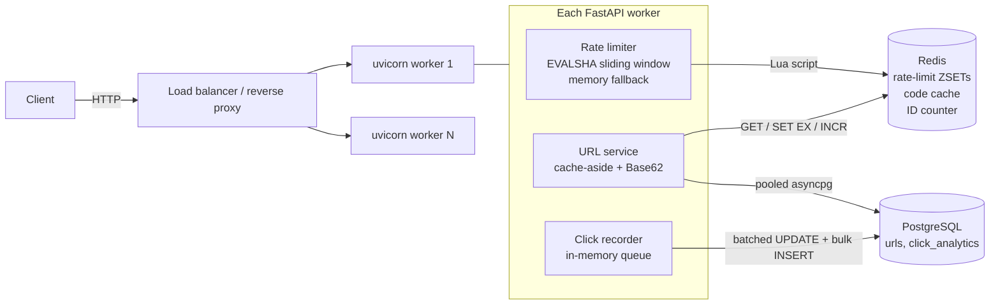
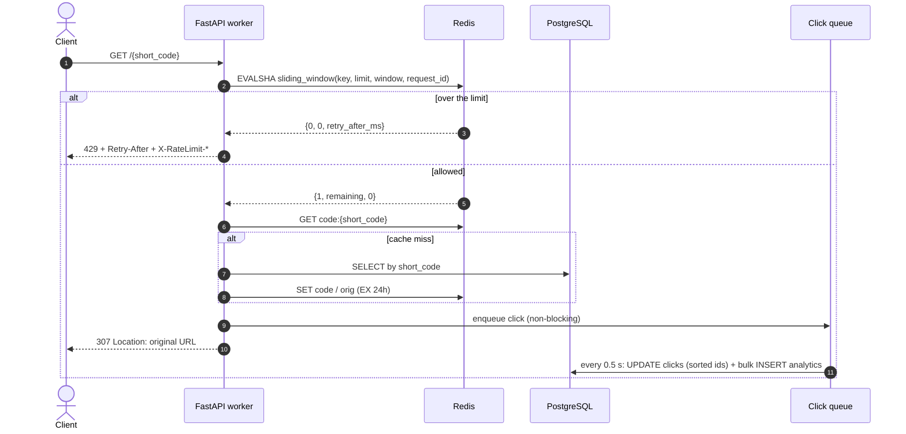

# OctoScale: URL Shortener with Atomic Rate Limiting

[](https://github.com/charan-reddy-dev/Octoscale-URL-Shortener/actions/workflows/ci.yml)

OctoScale is a URL shortener built on FastAPI, PostgreSQL and Redis. Short codes come from an atomic Redis counter encoded in Base62. Redirects are served from a Redis cache with a PostgreSQL fallback, every redirect and API call passes an atomic sliding-window rate limiter (a Lua script on a Redis sorted set), and click analytics are buffered and written in batches. When Redis is down, redirects and rate limiting keep working instead of failing.

A built-in dashboard lets users shorten links, copy them, and view click analytics for a code: a referrer breakdown and a table of recent clicks.

- Live demo: https://octoscale-web.onrender.com (Render free tier; the first request after idle can take up to a minute)
- API docs: https://octoscale-web.onrender.com/docs

## Verified benchmark results

Every number below is copied from [`benchmarks/results.json`](benchmarks/results.json), the raw output of [`benchmarks/load_test.py`](benchmarks/load_test.py) at commit `58e5618`, recorded on 2026-11-18.

**Throughput and latency**

| Scenario | Requests | Throughput | p50 | p95 | p99 | Max | Error rate |
|---|---:|---:|---:|---:|---:|---:|---:|
| Redirect `GET /{code}` (cached, 30 s) | 72,128 | **2,404.8 req/s** | 37.005 ms | 144.428 ms | 219.874 ms | 614.367 ms | 0 % (all 307) |
| Create `POST /api/v1/shorten` (15 s) | 17,378 | **1,155.8 req/s** | 73.909 ms | 318.08 ms | 629.644 ms | 2,994.277 ms | 0 % (all 201) |

Both scenarios ran at 126 concurrent keep-alive connections (6 load-generator processes × 21) spread over 20,000 simulated client IPs. Each redirect runs the rate-limit Lua script and a Redis cache lookup; each create runs the rate limiter, allocates an ID from the Redis counter and inserts a row into PostgreSQL.

**Rate-limiter accuracy:** a burst of 3× the limit from a single client

| Route | Limit per 60 s | Sent | Allowed | Rejected (429) | 429s with `Retry-After` | Exact |
|---|---:|---:|---:|---:|---:|:---:|
| Redirect | 600 | 1,800 | 600 | 1,200 | 1,200 | yes |
| API | 100 | 300 | 100 | 200 | 200 | yes |

All 2,100 burst decisions were made by the Redis backend (`X-RateLimit-Backend: redis`).

**Data integrity:** checked against PostgreSQL after the run

| Check | Expected | Actual |
|---|---:|---:|
| New URL rows (one per 201) | 18,478 | 18,478 |
| Duplicate short codes | 0 | 0 |
| New click rows (one per 307, written in batches) | 73,728 | 73,728 |
| Increase of `urls.clicks` counters | 73,728 | 73,728 |

**Environment:** Intel Core Ultra 5 235 (14 cores), 63.7 GB RAM, Windows 11, Python 3.14.7. The server ran 6 uvicorn workers against PostgreSQL 18.7 and Redis 5.0.14.1 (Windows port, persistence off), all on the same machine as the load generator. Settings: `LOG_LEVEL=warning`, `TRUST_PROXY_HEADERS=true`, default pool sizes.

**Reading these numbers:**
- Client, server, PostgreSQL and Redis shared one 14-core laptop, so the load generator competed with the server for CPU. Treat the results as a reproducible baseline for this code, not a production capacity figure.
- p95/p99 vary between runs on the same machine. In trial runs the redirect p95 ranged from about 35 ms to 150 ms.
- Python's HTTP client limits how much load one machine can generate.

### Reproduce

Start the stack (see [Quickstart](#quickstart)) with `TRUST_PROXY_HEADERS=true`, so each simulated client gets its own rate-limit bucket. Then run:

```bash
python benchmarks/load_test.py \
  --base-url http://127.0.0.1:8000 \
  --duration 30 --create-duration 15 \
  --concurrency 128 --processes 6 --clients 20000 --urls 1000 \
  --server-workers 6 --database "PostgreSQL 18.7 (local)" \
  --redis-url redis://127.0.0.1:6379/0 \
  --verify-db-url postgresql+asyncpg://postgres@127.0.0.1:5433/url_shortener \
  --same-host \
  --notes "uvicorn 6 workers, LOG_LEVEL=warning, TRUST_PROXY_HEADERS=true, Redis persistence off" \
  --output benchmarks/results.json
```

The server for the recorded run was started with:

```bash
APP_ENV=production LOG_LEVEL=warning TRUST_PROXY_HEADERS=true \
DATABASE_URL=postgresql+asyncpg://postgres@127.0.0.1:5433/url_shortener \
REDIS_URL=redis://127.0.0.1:6379/0 \
uvicorn app.main:app --host 127.0.0.1 --port 8000 --workers 6 --no-access-log
```

The script runs four phases:
1. **Setup:** creates 1,000 links and warms the cache.
2. **Redirect:** sustained redirect traffic.
3. **Create:** sustained create traffic.
4. **Limiter:** a 3× burst from one client against each rate-limited route.

It writes every number, plus hardware metadata, the git commit and the command, to the output JSON. `--verify-db-url` is optional; when set, the script also checks that every successful response produced exactly one database row.

### What the load test caught

The first recorded run reported 0 HTTP errors but only 7,120 of 75,980 clicks in the database. Click batches flushed by different workers updated `urls` rows in different orders, PostgreSQL detected deadlocks, and the writer dropped those batches.

The writer now increments counters in ascending id order, which makes deadlocks impossible, and it requeues a failed batch up to 3 times before counting it as dropped. The load test now verifies row counts, which is how the table above was produced.

---

## Architecture



### Redirect path



### Rate limiting

[`app/rate_limit.py`](app/rate_limit.py) loads one Lua script with `register_script` and calls it with `EVALSHA`; the script is reloaded automatically if Redis restarts. Inside the script, atomically on the Redis server:
1. Read the Redis clock (`TIME`), so all app instances share one clock.
2. Drop entries older than the window (`ZREMRANGEBYSCORE`) and count the rest (`ZCARD`).
3. If under the limit, add the request with a unique member (a UUID, so simultaneous requests never collapse into one entry) and set `PEXPIRE`. Otherwise return the time until the oldest entry leaves the window.

Rejected requests are not recorded, so a client that keeps retrying regains access as soon as the window allows. Responses carry `X-RateLimit-Limit`, `X-RateLimit-Remaining` and `X-RateLimit-Backend`, and a 429 adds `Retry-After`.

- **Separate limits:** `/api/v1/*` and redirects have their own per-client limits (`RATE_LIMIT_PER_MINUTE`, `REDIRECT_RATE_LIMIT_PER_MINUTE`).
- **Client identity:** by default the client is the socket address. With `TRUST_PROXY_HEADERS=true` it is the first `X-Forwarded-For` address; enable that only behind a proxy you control.
- **Fallback:** if Redis errors or times out (0.5 s socket timeout), a circuit breaker stops calling Redis for 5 s and an in-process sliding window with the same semantics takes over. Limits stay enforced, per worker process, instead of failing open.

### Short codes

IDs come from `INCR url_id_counter`, starting at 10,000,000, so codes are 4 Base62 characters until the counter passes 62⁴. If the counter key is missing (first start, or Redis lost its data), it is seeded from `MAX(id)` in PostgreSQL with `SET NX`. Concurrent first requests therefore cannot reset a counter that another request has already incremented; a test runs 25 concurrent allocations and checks they are all distinct.

Custom codes are checked first and protected by the unique constraint: a race on the same code returns 400, not 500. If Redis is down, existing links still redirect from PostgreSQL, but creating a link returns `503` with `Retry-After`, because no ID can be allocated safely.

### Click analytics

Redirects put click events on an in-memory queue and return immediately. A writer per worker flushes up to 1,000 events every 0.5 s in one transaction:
- one `executemany` UPDATE of the click counters, in ascending id order;
- one bulk INSERT of the analytics rows.

Writer stats (pending, written, retried, dropped) are reported by `GET /api/v1/health`.

### Connection pooling

- **Redis:** one shared `ConnectionPool` per worker (200 connections, 0.5 s timeouts, RESP2 so any Redis version works).
- **PostgreSQL:** an asyncpg pool (20 + 10 overflow, `pre_ping`, 30-minute recycle).
- **SQLite:** for local development, SQLite runs in WAL mode with a busy timeout.

---

## Quickstart

### Docker Compose (app + PostgreSQL + Redis)

```bash
docker compose up --build
```

- App and dashboard: http://localhost:8000
- API docs: http://localhost:8000/docs
- Health: http://localhost:8000/api/v1/health

Compose runs 2 uvicorn workers (`WEB_CONCURRENCY`), PostgreSQL 16 and Redis 7 with append-only persistence, and health-checks all three.

### Local, without Docker

Requires Python 3.12+ and a running Redis.

```bash
python -m venv .venv
source .venv/bin/activate            # Windows: .venv\Scripts\activate
pip install -r requirements.txt

export DATABASE_URL=sqlite+aiosqlite:///./octoscale.sqlite3   # or a postgresql:// URL
export REDIS_URL=redis://127.0.0.1:6379/0
uvicorn app.main:app --reload
```

### Configuration

| Variable | Default | Purpose |
|---|---|---|
| `DATABASE_URL` | local PostgreSQL | `postgresql://` URLs are rewritten to `postgresql+asyncpg://` |
| `REDIS_URL` | `redis://localhost:6379/0` | Cache, ID counter and rate-limit windows |
| `RATE_LIMIT_PER_MINUTE` | `100` | Per-client limit for `/api/v1/*` |
| `REDIRECT_RATE_LIMIT_PER_MINUTE` | `600` | Per-client limit for `GET /{code}` |
| `RATE_LIMIT_WINDOW_SECONDS` | `60` | Sliding-window length |
| `TRUST_PROXY_HEADERS` | `false` | Use `X-Forwarded-For` as client identity |
| `DB_POOL_SIZE` / `DB_MAX_OVERFLOW` | `20` / `10` | PostgreSQL pool per worker |
| `REDIS_MAX_CONNECTIONS` | `200` | Redis pool per worker |
| `REDIS_SOCKET_TIMEOUT` | `0.5` | Seconds before a Redis call counts as failed |
| `CLICK_FLUSH_INTERVAL_SECONDS` / `CLICK_BATCH_SIZE` | `0.5` / `1000` | Click writer batching |
| `LOG_LEVEL` | `info` | `warning` drops per-request access logs |
| `WEB_CONCURRENCY` | `1` | uvicorn workers in the Docker image |

---

## Tests

```bash
pytest --cov=app tests/
```

36 tests, 87 % line coverage, run in CI on every push.

- **Redis:** the suite uses [fakeredis](https://github.com/cunla/fakeredis-py) with Lua support, so the real rate-limit script, sorted sets and TTLs are exercised. SQLite in memory replaces PostgreSQL.
- **Rate limiter:**
  - exact limits, and remaining/`Retry-After` headers;
  - rejected requests are not counted;
  - a concurrent burst of 80 requests against a limit of 50 allows exactly 50;
  - separate redirect and API buckets, and trusted-proxy client identity;
  - fallback to memory when Redis fails.
- **Short codes:** race-free counter seeding.
- **Redis outage:** redirects keep working and creation returns 503.
- **Click writer:** batched writes, retry after a failed batch, and drop after 3 attempts.

---

## Deployment

The service is a single Docker image that needs PostgreSQL and Redis (`DATABASE_URL`, `REDIS_URL`, `BASE_URL`, `APP_ENV`; see `.env.example`). Set `WEB_CONCURRENCY` for the number of workers.

- **Render:** `render.yaml` defines the web service, a Key Value (Redis-compatible) instance and PostgreSQL. Create a Blueprint from this repository and set `BASE_URL`. Render terminates TLS at its proxy, so set `TRUST_PROXY_HEADERS=true` for per-client rate limits.
- **Railway:** build from the `Dockerfile`, add PostgreSQL and Redis, and set `DATABASE_URL=${{Postgres.DATABASE_URL}}`, `REDIS_URL=${{Redis.REDIS_URL}}`, `BASE_URL` and `APP_ENV=production`.

## Limitations

- **Click durability:** clicks wait in memory for up to 0.5 s; a crash loses that buffer. A durable stream such as Redis Streams or Kafka would close the gap.
- **Fallback limits:** the in-memory limiter applies per worker process, so during a Redis outage the effective limit is the configured limit × number of workers.
- **Schema:** tables are created with `create_all` at startup (retried when several workers race); there are no Alembic migrations.
- **Analytics endpoint:** it loads all click rows for a link and sorts them in memory, which slows down for very popular links.
- **Custom codes:** custom codes are not reserved against future counter values, so a 4-character custom code could later collide with a generated one. The unique constraint rejects it.
- **Benchmark scope:** the recorded run used a single machine and the Windows port of Redis 5. There is no benchmark yet against the Docker Compose stack or across multiple hosts.
